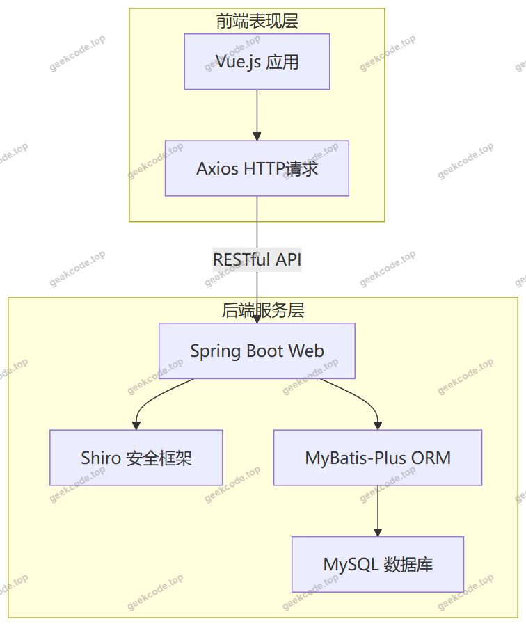
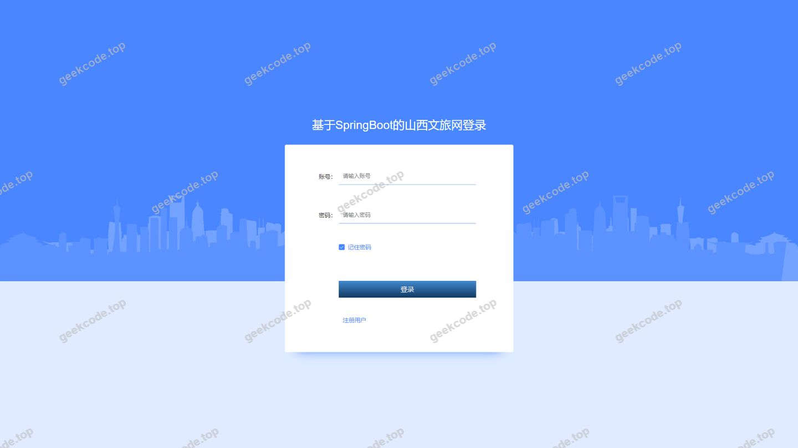
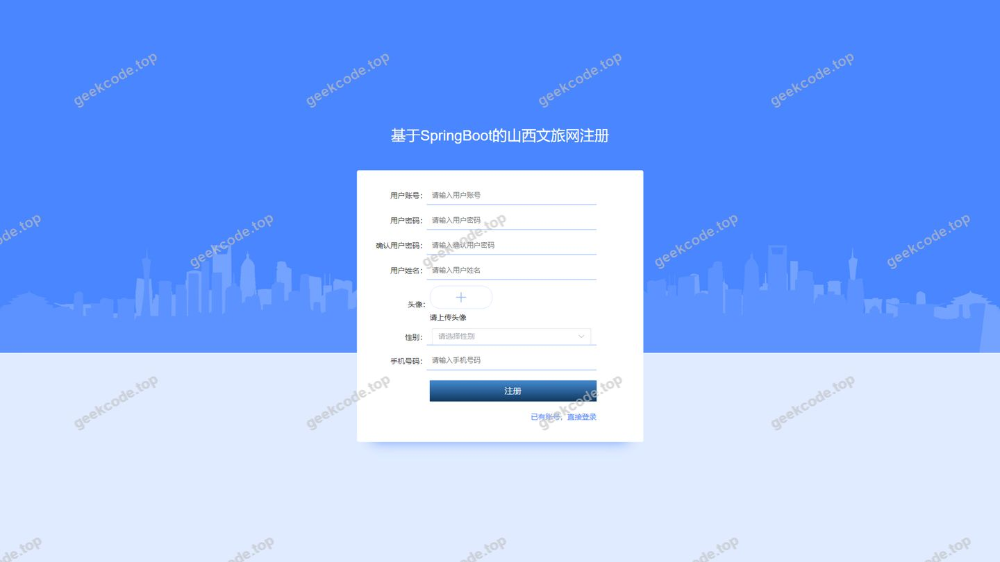

# 基于SpringBoot的山西文旅网

> 🎓 **计算机毕业设计 · 基于SpringBoot的山西文旅网**
>
> 本仓库只放**项目介绍 + 运行截图**（截图是站点带水印的原图，存在仓库 `images/` 里）。
>
> 👉 **完整可运行源码 / 数据库脚本 / 部署文档：[点我获取](https://geekcode.top/archives/%E5%9F%BA%E4%BA%8ESpringBoot%E7%9A%84%E5%B1%B1%E8%A5%BF%E6%96%87%E6%97%85%E7%BD%91?utm_source=github)**
>
> 💬 咨询微信：**ir9372**　|　🌐 更多项目：[极客代码 geekcode.top](https://geekcode.top/?utm_source=github)
>
> 📌 项目详情页：<https://geekcode.top/archives/%E5%9F%BA%E4%BA%8ESpringBoot%E7%9A%84%E5%B1%B1%E8%A5%BF%E6%96%87%E6%97%85%E7%BD%91?utm_source=github>

<table><td width="230" align="center"> <b>扫码加微信 ir9372</b></td><td valign="middle">📦 源码 = 项目介绍 + 全部运行截图 + 数据库 + 部署文档 👉 点上方任意截图，直接跳到 <b>极客代码 geekcode.top</b> 详情页</td></table>

---

<h1>基于SpringBoot的山西文旅网</h1>
<h2>项目概述</h2>

本项目为“基于SpringBoot的山西文旅网”，旨在构建一个集景点展示、酒店预订、攻略分享及门票购买于一体的综合性旅游服务平台。系统采用前后端分离架构，核心功能涵盖用户注册登录、景点与酒店信息管理、旅游攻略发布、在线预订及收藏评论等模块。适用人群包括普通游客（前台用户）和运营人员/管理员（后台）。技术架构上，后端基于 Spring Boot 框架，集成 MyBatis-Plus 进行数据持久化操作，并使用 Shiro 实现安全权限控制；前端采用 Vue 框架开发，通过 RESTful API 与后端交互。该项目致力于提升山西文化旅游资源的数字化管理水平，优化用户体验，实现旅游信息的便捷获取与服务的高效对接。

<h2>技术架构</h2>
<h3>1. 总体架构设计</h3>

系统采用经典的前后端分离模式（Vue-integrated），整体分为表现层、业务逻辑层和数据访问层。

<h3>2. 核心技术选型理由</h3>
<ul>
<li><strong>Spring Boot</strong>: 作为后端基础框架，提供自动配置和内嵌服务器特性，简化了 Java EE 应用的搭建过程，确保系统的高可用性和快速迭代能力。</li>
<li><strong>MyBatis-Plus</strong>: 在 MyBatis 基础上增强，提供了通用的 CRUD 接口和条件构造器，大幅减少了 SQL 编写工作量，提升了数据访问层的开发效率和维护性。</li>
<li><strong>Apache Shiro</strong>: 用于处理身份认证（Authentication）和授权（Authorization）。鉴于项目包含前台用户和后台管理员不同角色，Shiro 能够灵活管理会话状态和权限边界，保障系统安全性。</li>
<li><strong>MySQL</strong>: 关系型数据库，用于存储用户信息、景点详情、酒店订单、评论内容等结构化数据，具备成熟的事务处理能力。</li>
<li><strong>Vue.js</strong>: 前端采用 Vue 框架，利用其组件化开发和响应式数据绑定特性，构建动态的用户界面，实现列表展示、详情页渲染及表单交互。</li>
</ul>
<h3>3. 数据库设计要点</h3>

根据路由和截图分析，数据库主要实体包括：

<ul>
<li><strong>用户相关表</strong>: <code>yonghu</code> (用户), <code>yunyingshang</code> (运营商/商家)。</li>
<li><strong>资源分类表</strong>: <code>jingdianleixing</code> (景点类型), <code>jiudianleixing</code> (酒店类型), <code>gonglveleixing</code> (攻略类型)。</li>
<li><strong>核心业务表</strong>: <code>jingdianxinxi</code> (景点信息), <code>jiudianxinxi</code> (酒店信息), <code>lvyougonglve</code> (旅游攻略), <code>menpiaogoumai</code> (门票购买记录), <code>jiudianyuding</code> (酒店预订记录)。</li>
<li><strong>互动与辅助表</strong>: <code>discussjiudianxinxi</code> (酒店评论), <code>discussjingdianxinxi</code> (景点评论), <code>storeup</code> (收藏记录), <code>config</code> (系统配置)。</li>
</ul>
<h2>功能模块</h2>
<h3>1. 前台用户端功能</h3>

前台面向注册用户和普通访客，提供浏览、查询及交易服务。

<ul>
<li><strong>首页与导航</strong>: 展示平台概览，提供各模块入口。</li>
<li><strong>用户中心</strong>:</li>
<li><strong>注册与登录</strong>: 新用户注册账号，老用户登录系统。</li>
<li><strong>个人信息管理</strong>: 查看和修改个人基本信息 (<code>/index/yonghuCenter</code>, <code>/index/yonghuDetail</code>)。</li>
<li><strong>景点服务</strong>:</li>
<li><strong>景点浏览</strong>: 按类型筛选或搜索景点信息 (<code>/index/jingdianxinxiList</code>)。</li>
<li><strong>景点详情</strong>: 查看具体景点的图片、介绍及评价 (<code>/index/jingdianxinxiDetail</code>)。</li>
<li><strong>景点评论</strong>: 用户对已游览景点发表评价 (<code>/index/discussjingdianxinxi</code> 关联功能)。</li>
<li><strong>门票购买</strong>: 在线选购景点门票并生成订单 (<code>/index/menpiaogoumaiList</code>)。</li>
<li><strong>酒店服务</strong>:</li>
<li><strong>酒店浏览</strong>: 按类型筛选酒店列表 (<code>/index/jiudianxinxiList</code>)。</li>
<li><strong>酒店详情</strong>: 查看酒店设施、价格及用户评价 (<code>/index/jiudianxinxiDetail</code>)。</li>
<li><strong>酒店预约</strong>: 提交酒店预订申请 (<code>/index/jiudianyudingAdd/List</code>)。</li>
<li><strong>酒店评论</strong>: 对入住体验进行反馈 (<code>/index/discussjiudianxinxi</code> 关联功能)。</li>
<li><strong>旅游攻略</strong>:</li>
<li><strong>攻略浏览</strong>: 查看各类别的旅游指南 (<code>/index/lvyougonglveList</code>)。</li>
<li><strong>攻略详情</strong>: 阅读完整的图文攻略 (<code>/index/lvyougonglveDetail</code>)。</li>
<li><strong>收藏功能</strong>: 用户可收藏感兴趣的景点、酒店或攻略 (<code>/index/storeupList</code>)。</li>
<li><strong>运营商展示</strong>: 查看入驻平台的运营商信息 (<code>/index/yunyingshangList/Detail</code>)。</li>
</ul>
<h3>2. 后台管理端功能</h3>

后台面向管理员和运营商，负责内容维护、订单管理及系统配置。

<ul>
<li><strong>系统管理</strong>:</li>
<li><strong>登录页</strong>: 管理员/运营商身份验证入口。</li>
<li><strong>配置管理</strong>: 设置系统全局参数 (<code>/config</code>)。</li>
<li><strong>基础数据维护</strong>:</li>
<li><strong>景点类型管理</strong>: 增删改查景点分类标签 (<code>/jingdianleixing</code>)。</li>
<li><strong>酒店类型管理</strong>: 增删改查酒店分类标签 (<code>/jiudianleixing</code>)。</li>
<li><strong>攻略类型管理</strong>: 增删改查攻略分类标签 (<code>/gonglveleixing</code>)。</li>
<li><strong>内容管理</strong>:</li>
<li><strong>景点信息管理</strong>: 发布、编辑、删除景点详细资料 (<code>/jingdianxinxi</code>)。</li>
<li><strong>酒店信息管理</strong>: 发布、编辑、删除酒店详细资料 (<code>/jiudianxinxi</code>)。</li>
<li><strong>旅游攻略管理</strong>: 上传和管理旅游文章内容 (<code>/lvyougonglve</code>)。</li>
<li><strong>互动管理</strong>:</li>
<li><strong>酒店评论管理</strong>: 审核和管理用户对酒店的评论 (<code>/discussjiudianxinxi</code>)。</li>
<li><strong>景点评论管理</strong>: 审核和管理用户对景点的评论 (<code>/discussjingdianxinxi</code>)。</li>
<li><strong>业务订单管理</strong>:</li>
<li><strong>门票购买管理</strong>: 查看和处理用户的门票订单 (<code>/menpiaogoumai</code>)。</li>
<li><strong>酒店预订管理</strong>: 查看和处理用户的酒店预订记录 (<code>/jiudianyuding</code>)。</li>
<li><strong>用户与角色管理</strong>:</li>
<li><strong>用户管理</strong>: 查看和管理前台注册用户信息 (<code>/yonghu</code>)。</li>
<li><strong>运营商管理</strong>: 管理入驻商家的信息和状态 (<code>/yunyingshang</code>, <code>/yunyingshangCenter</code>)。</li>
<li><strong>收藏管理</strong>: 查看用户的收藏记录 (<code>/storeup</code>)。</li>
</ul>
<h2>用户角色与权限</h2>

根据代码上下文中的路由定义（如 <code>/yunyingshangRegister</code>, <code>/yonghu</code>）及菜单结构，系统主要存在以下三类角色：

<h3>1. 超级管理员 (Admin)</h3>

拥有系统的最高权限，负责全局配置和所有数据的监管。

<ul>
<li><strong>可访问模块</strong>: 所有后台路由 (<code>/config</code>, <code>/yonghu</code>, <code>/jingdianxinxi</code>, <code>/jiudianxinxi</code>, <code>/lvyougonglve</code>, <code>/menpiaogoumai</code>, <code>/jiudianyuding</code>, <code>/discuss...</code>, <code>/...leixing</code>, <code>/storeup</code>, <code>/yunyingshang</code> 等)。</li>
<li><strong>权限描述</strong>: 可以进行所有内容的增删改查，管理用户和运营商账户，审核评论，处理所有类型的订单，以及配置系统参数。</li>
</ul>
<h3>2. 运营商 (Yunyingshang)</h3>

指入驻平台的第三方服务提供商（如旅行社、景区管理处等），具有部分管理权限。

<ul>
<li><strong>可访问模块</strong>:</li>
<li><strong>注册/登录</strong>: <code>/yunyingshangRegister</code>, <code>/yunyingshangCenter</code>。</li>
<li><strong>自身业务管理</strong>: 推测可管理与其相关的景点、酒店、攻略及订单数据（具体范围取决于后端逻辑隔离，通常限于其所属资源）。</li>
<li><strong>查看</strong>: 可能拥有查看特定统计报表或自身名下用户互动的权限。</li>
<li><strong>权限描述</strong>: 主要负责维护自己发布的景点、酒店、攻略信息，处理归属于自己的门票和酒店订单，回复相关评论。</li>
</ul>
<h3>3. 普通用户 (Yonghu)</h3>

前台消费者，主要使用浏览和交易功能。

<ul>
<li><strong>可访问模块</strong>:</li>
<li><strong>个人中心</strong>: <code>/index/yonghuCenter</code>, <code>/index/yonghuDetail</code>。</li>
<li><strong>浏览与搜索</strong>: 所有 List 和 Detail 路由 (<code>/index/jingdianxinxiList</code>, <code>/index/jiudianxinxiList</code>, <code>/index/lvyougonglveList</code> 等)。</li>
<li><strong>交互操作</strong>:</li>
<li><strong>添加/创建</strong>: <code>/index/jingdianxinxiAdd</code> (若允许UGC), <code>/index/jiudianyudingAdd</code>, <code>/index/menpiaogoumai</code> (下单动作)。</li>
<li><strong>收藏</strong>: <code>/index/storeupList</code> (执行收藏操作)。</li>
<li><strong>评论</strong>: 在前台详情页触发评论提交接口。</li>
<li><strong>权限描述</strong>: 只能查看公开信息，进行注册登录，修改个人资料，发起预订和购买请求，发表收藏和评论。无法访问后台管理页面。</li>
</ul>
<h2>项目特色与创新点</h2>
<ol>
<li><strong>垂直领域定制化</strong>: 针对“山西文旅”这一特定地域和文化背景，设计了专门的景点、酒店和攻略分类体系，相较于通用电商系统，更贴合旅游行业的信息展示需求（如强调图片展示、地理位置、游玩时长等隐含字段）。</li>
<li><strong>全流程闭环服务</strong>: 实现了从“信息获取”（浏览景点/攻略）到“决策支持”（查看评论/收藏）再到“交易转化”（门票购买/酒店预订）的完整用户旅程，增强了平台的实用性和用户粘性。</li>
<li><strong>多角色协同机制</strong>: 引入了“运营商”角色，区别于传统的单管理员模式，支持多方主体参与内容供给和服务提供，有利于构建生态化的旅游服务平台。</li>
<li><strong>轻量级高安全架构</strong>: 选用 Shiro 而非 Spring Security，体现了在中小型项目中对轻量化和易用性的追求，同时保证了基本的认证授权安全；结合 MyBatis-Plus 的代码生成能力，显著提升了开发效率。</li>
</ol>
<h2>部署环境</h2>

为确保项目正常运行，需准备以下软硬件环境：

<h3>1. 硬件环境</h3>
<ul>
<li><strong>CPU</strong>: Intel Core i5 及以上或同等性能处理器。</li>
<li><strong>内存</strong>: 建议 8GB 及以上 RAM。</li>
<li><strong>硬盘</strong>: 至少 50GB 可用存储空间（用于安装软件及存储数据库文件）。</li>
</ul>
<h3>2. 软件环境</h3>
<ul>
<li><strong>操作系统</strong>: Windows 10/11, Linux (CentOS 7+, Ubuntu 18.04+), 或 macOS。</li>
<li><strong>Java 开发工具包 (JDK)</strong>: JDK 1.8 或更高版本（推荐 JDK 8 LTS，以兼容大多数 Spring Boot 旧版本依赖）。</li>
<li><strong>数据库管理系统</strong>: MySQL 5.7 或 MySQL 8.0 Community Edition。</li>
<li><strong>Web 服务器</strong>: 内置 Tomcat (由 Spring Boot 提供)，生产环境可选 Nginx 作为反向代理。</li>
<li><strong>Node.js</strong>: 版本 &gt;= 12.x (用于编译和运行 Vue 前端项目)。</li>
<li><strong>包管理工具</strong>: npm 或 yarn。</li>
<li><strong>开发工具 (IDE)</strong>: IntelliJ IDEA (后端), VS Code (前端)。</li>
<li><strong>其他依赖</strong>: Maven (用于后端项目构建和依赖管理)。</li>
</ul>
<h3>3. 启动步骤简述</h3>
<ol>
<li><strong>数据库初始化</strong>: 导入项目提供的 <code>.sql</code> 脚本至 MySQL，创建数据库及表结构。</li>
<li><strong>后端配置</strong>: 修改 <code>application.yml</code> 中的数据库连接 URL、用户名和密码。</li>
<li><strong>后端启动</strong>: 使用 Maven 命令 <code>mvn spring-boot:run</code> 或在 IDE 中直接运行主类。</li>
<li><strong>前端安装</strong>: 进入前端目录，执行 <code>npm install</code> 安装依赖。</li>
<li><strong>前端启动</strong>: 执行 <code>npm run serve</code> (或 <code>dev</code>) 启动本地开发服务器。</li>
<li><strong>访问系统</strong>: 浏览器访问前端地址，测试前后端联调情况。</li>
</ol>
<h2>五、技术特性</h2>
<ul>
<li>前后端集成部署，前端资源打包至后端 static 目录</li>
<li>使用 MyBatis-Plus 简化数据访问层开发</li>
<li>集成 Shiro 权限框架实现角色权限控制</li>
</ul>
<h2>六、功能模块截图</h2>
<h3>前台用户端</h3>
<h4>前台-首页</h4>

<h4>前台-登录</h4>

<h4>前台-用户注册</h4>

<h3>后台管理端</h3>
<h4>后台-登录页</h4>

<h4>后台-景点类型</h4>

<h4>后台-景点信息</h4>

<h4>后台-酒店类型</h4>

<h4>后台-酒店信息</h4>

<h4>后台-酒店信息评论</h4>

<h4>后台首页</h4>

<h4>后台-我的收藏</h4>

---

## 获取完整源码

| 项目 | 说明 |
| --- | --- |
| 项目名 | 基于SpringBoot的山西文旅网 |
| 运行截图 | 本文 4 张（站点带水印原图，仓库 `images/` 目录） |
| 完整源码 | [https://geekcode.top/archives/%E5%9F%BA%E4%BA%8ESpringBoot%E7%9A%84%E5%B1%B1%E8%A5%BF%E6%96%87%E6%97%85%E7%BD%91?utm_source=github](https://geekcode.top/archives/%E5%9F%BA%E4%BA%8ESpringBoot%E7%9A%84%E5%B1%B1%E8%A5%BF%E6%96%87%E6%97%85%E7%BD%91?utm_source=github) |
| 咨询微信 | **ir9372**（备注：jingpin-yuanma） |
| 更多项目 | [极客代码 geekcode.top](https://geekcode.top/?utm_source=github) |

> 需要源码、部署、改配置、跑不起来等问题，加微信 ir9372 沟通，说明项目名即可。
